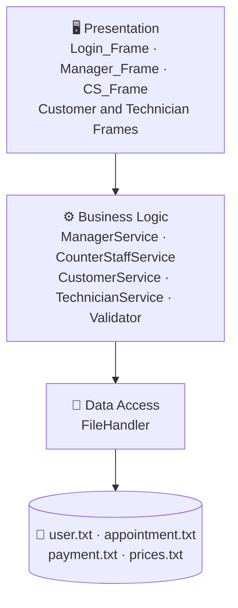
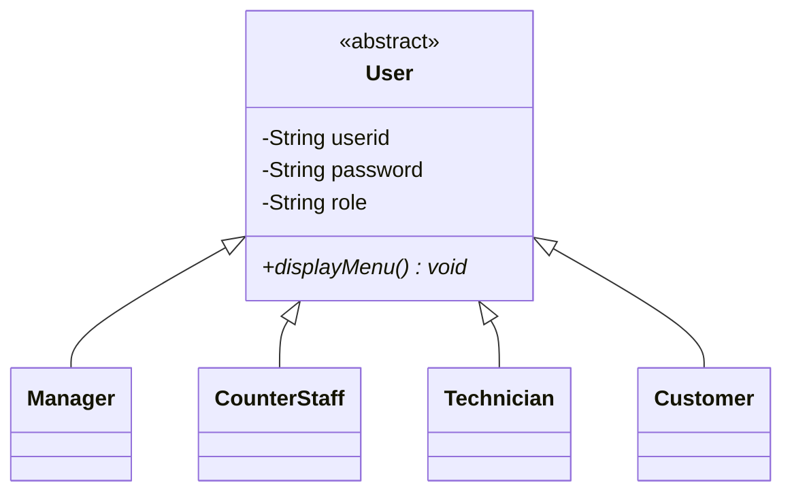

<div align="center">

# 🚗 APU Automotive Service Centre (APU-ASC)

**A role-based Java desktop app that runs a car service centre, from booking to payment.**


*Object Oriented Development with Java (032026-KTS) · Asia Pacific University of Technology and Innovation*

[Features](#-features) · [Architecture](#-architecture) · [OOP](#-oop-concepts) · [Getting Started](#-getting-started) · [Limitations](#-known-limitations) · [Team](#-team)

</div>

---

## ✨ Overview

APU-ASC digitalises the daily work of an automotive service centre: appointments, customers, staff, payments and service records. Each person who uses the system gets a dashboard built for their job.

No database is used. All data is stored in plain text files, and the code is split into clean layers (UI, services, file handling).

## 🎭 Features

Four roles, four dashboards:

| Role | What they can do |
|---|---|
| 👔 **Manager** | Add, edit and delete staff · Set service prices · View customer feedback · Reports and statistics |
| 🧾 **Counter Staff** | Add, edit and delete customers · Create appointments · Collect payments · Generate receipts |
| 🔧 **Technician** | View job details · Update job status · Submit feedback |
| 🙋 **Customer** | View service and payment history · Submit feedback · Manage profile |

Everyone can log in securely to their own dashboard and edit their own profile.

<details>
<summary>⭐ <b>Bonus features (14 extras beyond the brief)</b></summary>

<br>

| Role | Extra features |
|---|---|
| 👔 Manager | All appointments · Technician performance · All payments · System statistics with bar charts · Dashboard overview |
| 🔧 Technician | My performance · My appointments · Weekly schedule · Job history with date filter |
| 🧾 Counter Staff | Search appointments · Daily summary export |
| 🙋 Customer | View appointments · Cancel appointment · View receipt |

</details>

### 🛠️ Service types

| Type | Duration |
|---|---|
| Normal | 60 minutes |
| Major | 180 minutes |

Prices for both are set by the Manager.

## 🏗️ Architecture

Three tiers, kept separate on purpose:



**Entry point:** `Main.java` opens `Login_Frame`, which checks credentials and routes the user to the right dashboard by role.

## 🧬 OOP Concepts



| Concept | Where it shows up |
|---|---|
| **Inheritance** | Abstract `User` extended by `Manager`, `CounterStaff`, `Technician`, `Customer` |
| **Encapsulation** | Private fields with getters and setters in `User`, `Appointment`, `Payment` |
| **Abstraction** | Abstract `User` and `displayMenu()`; service classes and `FileHandler` hide logic from the UI |
| **Polymorphism** | Overridden `displayMenu()` and `toString()`; role resolved at runtime on login; mixed-role `ArrayList` |

## 🗂️ Data Files

| File | Stores |
|---|---|
| `user.txt` | All user accounts |
| `appointment.txt` | Appointments, status, feedback comments |
| `payment.txt` | Payment records |
| `prices.txt` | Normal and Major service prices |

The Counter Staff daily summary is exported as a text file too.

## 📸 Screenshots

> Add your screenshots to a `screenshots/` folder and replace the placeholders below.

| Login | Manager | Technician |
|:---:|:---:|:---:|
| `screenshots/login.png` | `screenshots/manager.png` | `screenshots/technician.png` |

| Counter Staff | Customer |
|:---:|:---:|
| `screenshots/counter-staff.png` | `screenshots/customer.png` |

## 🚀 Getting Started

**Prerequisite:** JDK 14 or later (the code uses switch expressions).

```bash
# 1. Clone
git clone https://github.com/sana-syed123/APU-CAR-SERVICE-MANAGEMENT-SYSTEM.git
cd APU-CAR-SERVICE-MANAGEMENT-SYSTEM

# 2. Compile (adjust the path to your source folder)
javac -d out src/*.java

# 3. Run
java -cp out Main
```

Prefer an IDE? Open the project in IntelliJ IDEA, NetBeans or Eclipse and run `Main.java`.

> 💡 Keep the `.txt` data files in the folder the app runs from.

## ⚠️ Known Limitations

- **CSV-style storage:** commas in user input (vehicle details, comments, feedback) can corrupt records.
- **Plain-text passwords:** no hashing or salting.
- **No concurrency control:** simultaneous edits can overwrite each other.
- **Non-atomic ID generation:** IDs come from scanning for the highest existing one, so duplicates are possible under concurrent use.
- **Weekly schedule:** the technician view only shows the current week.
- **Leftover method:** `displayMenu()` comes from a console-based design and does nothing in the Swing GUI.

**Future ideas:** move to a real database, hash passwords, add file locking, and let technicians browse any week.

## 👥 Team

| | Member | Module |
|---|---|---|
| 👔 | **Mohammad Hazik Allaie** | Manager |
| 🧾 | **Syed Muhammad Bilal Umar** | Counter Staff |
| 🔧 | **Sana Syed** | Technician |
| 🙋 | **All members** | Customer |

## 📚 Academic Note

Created as coursework at APU. If you're a student, please don't submit this as your own work.

---

<div align="center">

Made with ☕ and Java Swing

</div>
